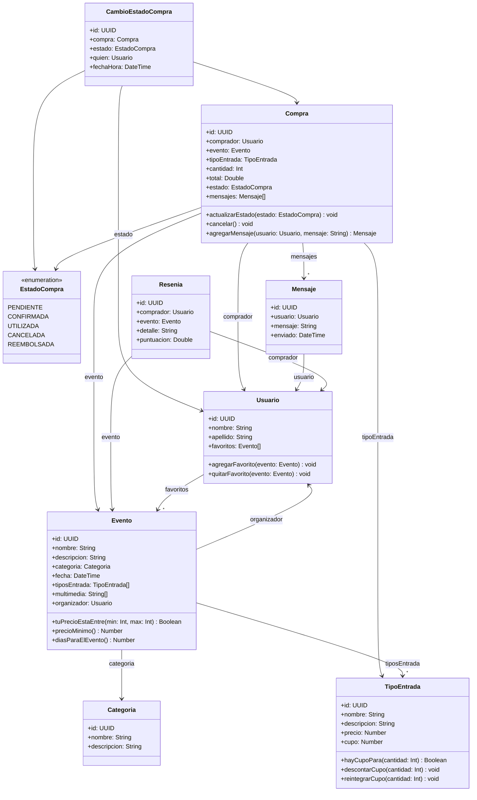

# 🎟️ AI Ticket It — Plataforma de Venta de Entradas para Eventos

**Trabajo Práctico Individual Integrador — Desarrollo con Inteligencia Artificial (2C 2026)**  
**Universidad Tecnológica Nacional — Facultad Regional Buenos Aires (UTN.BA)**  
**Cátedra:** Desarrollo de Software  
**Alumna:** Sabrina Rabaglia  

---

## 📋 Descripción General

**AI Ticket It** es una plataforma diseñada para conectar de manera simple, transparente y segura a **organizadores de espectáculos** con **asistentes/compradores de entradas**.

- **Para Organizadores:** permite publicar eventos con descripciones detalladas, fecha, material multimedia y múltiples tipos de entrada (por ejemplo: *Campo General*, *Platea*, *VIP*) configurando el precio y cupo de cada uno; supervisar las ventas agrupadas por estado y controlar la disponibilidad remanente en tiempo real; y responder consultas de los compradores.
- **Para Compradores:** permite explorar el catálogo de eventos, buscar por texto o categoría, filtrar por rango de precios, ordenar por **precio, fecha o reputación del organizador**, guardar eventos favoritos, adquirir entradas validando cupo disponible, hacer el seguimiento del estado de cada compra (incluyendo los días faltantes para el evento cuando está confirmada), conversar con el organizador mediante un chat integrado en la compra, solicitar la cancelación/reembolso antes del evento y calificar la experiencia una vez utilizada la entrada.

---

## 🏗️ Arquitectura y Stack Tecnológico

El proyecto está organizado en dos módulos principales dentro del repositorio:

```text
2026-2C-lu-sa-TPI-Rabaglia-Sabrina/
├── docs/
│   └── enunciado_TPI.pdf          # Enunciado oficial y casos de uso
├── backend/                       # API RESTful (Node.js + Express 5)
│   ├── src/
│   │   ├── config/
│   │   │   └── swagger.js         # Especificación OpenAPI 3.0 / Swagger UI
│   │   ├── controllers/           # Controladores HTTP (Express)
│   │   ├── data/
│   │   │   └── seed.js            # Datos iniciales en memoria con UUIDs fijos
│   │   ├── middlewares/
│   │   │   ├── errorHandler.js    # Mapeo centralizado de excepciones a códigos HTTP
│   │   │   └── validateRequest.js # Validación de payloads entrantes con Zod
│   │   ├── models/                # Capa de Dominio Rica (Entidades, Enum y Errores)
│   │   ├── repositories/          # Capa de Persistencia en Memoria (Map + UUID)
│   │   ├── routes/                # Definición de rutas RESTful
│   │   ├── services/              # Orquestación de Casos de Uso y lógica de aplicación
│   │   └── validators/            # Esquemas de validación de entrada (Zod)
│   │   └── app.js                 # Configuración de Express y middlewares globales
│   ├── tests/                     # Suites de pruebas (Dominio, Repositorios, Servicios y API)
│   └── server.js                  # Punto de entrada del servidor HTTP
└── frontend/                      # Aplicación Mobile (React Native + Expo en JavaScript .js/.jsx)
    ├── .env                       # URL de conexión LAN al backend (EXPO_PUBLIC_API_URL)
    ├── jsconfig.json              # Configuración de alias @/* -> ./src/*
    └── src/
        ├── api/                   # Cliente HTTP fetch y módulos REST (usuarios, categorias, eventos, compras, resenias)
        ├── app/                   # Rutas Expo Router: login, (comprador), (organizador), evento/*, compra/*
        ├── components/            # Componentes UI reutilizables en español (TarjetaEvento, InsigniaEstado, BarraCupo...)
        ├── context/               # SesionContext (usuario activo + modo COMPRADOR/ORGANIZADOR)
        ├── hooks/                 # Hooks de @tanstack/react-query (useEventos, useCompras, useFavoritos...)
        ├── lib/                   # formato.js (moneda ARS y fechas es-AR) y estadoCompra.js
        └── tema.js                # Sistema de diseño centralizado (colores, espaciado, tipografia)
```

### Tecnologías del Frontend
- **Framework:** Expo (SDK 58) + React Native (`0.88`) en **JavaScript (`.js` / `.jsx`)**
- **Navegación:** Expo Router (tabs por modo + stacks compartidos)
- **Estado de Servidor:** `@tanstack/react-query` (caché, mutaciones optimistas, polling de chat cada 5s)
- **Formularios y Validación:** `react-hook-form` + `zod` + `@hookform/resolvers`
- **Fechas y Moneda:** `date-fns` (`es` locale) + `Intl.NumberFormat('es-AR')`
- **Íconos, Imágenes y Sesión:** `@expo/vector-icons` (`Ionicons`), `expo-image`, `@react-native-async-storage/async-storage`

### Tecnologías del Backend
- **Runtime:** Node.js (ES Modules)
- **Framework Web:** Express `^5.3.0`
- **Validación de Esquemas:** Zod `^4.6.7`
- **Documentación Interactiva:** `swagger-ui-express` (OpenAPI 3.0)
- **Seguridad y Logging:** `helmet`, `cors`, `morgan`, `dotenv`
- **Testing:** Test Runner nativo de Node.js (`node:test` + `node:assert/strict`)

---

## 🧠 Modelo de Dominio y Decisiones de Diseño

Se implementó un **Modelo de Dominio Rico (Rich Domain Model)** en `backend/src/models/` respetando fielmente el **Diagrama Tentativo** de la cátedra:

1. **Roles contextuales en `Usuario`:** siguiendo el modelo conceptual del enunciado, existe una única entidad `Usuario` que actúa como **Organizador** cuando publica un `Evento` (`evento.organizador`) y como **Comprador** cuando realiza una `Compra` (`compra.comprador`) o emite una `Resenia`. Esto permite que cualquier usuario pueda tanto asistir a eventos como organizar los propios, validando los permisos de cada operación en función de su vínculo con el recurso concreto.
2. **Desacoplamiento de `CambioEstadoCompra`:** el historial de auditoría de transiciones de estado referencia a la `Compra`, al `EstadoCompra` y al `Usuario` responsable (`quien`) sin contaminar la colección interna de `Compra`.
3. **Reglas de negocio encapsuladas en las entidades:**
   - `TipoEntrada`: verifica disponibilidad (`hayCupoPara(cantidad)`), descuenta cupo al comprar (`descontarCupo`) y lo reintegra en caso de cancelación (`reintegrarCupo`).
   - `Evento`: evalúa si ofrece entradas dentro de un rango de precios (`tuPrecioEstaEntre(min, max)`), calcula su `precioMinimo()` para ordenamientos y determina si ya ocurrió o cuántos días restan para su realización (`diasParaElEvento()`).
   - `Compra`: calcula automáticamente su `total`, retorna los días faltantes únicamente cuando se encuentra en estado `CONFIRMADA` (`diasFaltantesParaEvento()`), valida que solo pueda cancelarse si **no está en estado `UTILIZADA` y el evento aún no ocurrió** (`puedeCancelarse()` / `cancelar()`), valida que solo pueda reseñarse cuando está `UTILIZADA` (`puedeSerReseniada()`) y restringe el chat interno exclusivamente al comprador y al organizador del evento (`agregarMensaje()`).
   - `Resenia`: valida que la puntuación numérica se encuentre entre `1` y `5` y permite consultar la reputación acumulada de cada organizador.



---

## 🚀 Instalación y Ejecución del Backend

### 1. Requisitos previos
- **Node.js** `v20+` (o `v22+`) instalado.

### 2. Instalar dependencias
```bash
cd backend
npm install
```

### 3. Variables de entorno
El proyecto incluye un archivo `.env` por defecto (puerto `3000`). Si deseás personalizarlo:
```env
PORT=3000
```

### 4. Iniciar el servidor
```bash
# Modo desarrollo (con recarga automática vía nodemon)
npm run dev

# Modo estándar
npm start
```
Una vez iniciado, el servidor escuchará en:
- **API Base URL:** `http://localhost:3000/api`
- **Documentación Interactiva (Swagger UI):** `http://localhost:3000/api-docs`
- **Especificación OpenAPI JSON:** `http://localhost:3000/api-docs.json`

---

## 📱 Instalación y Ejecución del Frontend (React Native + Expo)

### 1. Instalar dependencias
```bash
cd frontend
npm install
```

### 2. Configurar la IP local en `.env`
Para probar en un teléfono físico con **Expo Go**, `localhost` apunta al propio teléfono. Por eso el archivo `frontend/.env` define la IP LAN de la computadora donde corre el backend:
```env
EXPO_PUBLIC_API_URL=http://10.15.31.38:3000
```
*(Si cambiás de red Wi-Fi, actualizá esa IP por la IPv4 que muestre `ipconfig`. En emulador Android hace fallback automático a `http://10.0.2.2:3000` y en iOS/Web a `http://localhost:3000`).*

### 3. Iniciar Expo
```bash
cd frontend
npx expo start
```
Escaneá el código QR con la app **Expo Go** (o presioná `a` para abrir en emulador Android / `w` para Web).

---

## 🧪 Ejecución de Pruebas Automatizadas

El backend cuenta con **30 pruebas automatizadas** distribuidas en 4 suites que verifican el modelo de dominio, los repositorios en memoria, la capa de servicios y los endpoints HTTP de la API REST:

```bash
cd backend
npm test
```

- `tests/domain.test.js`: pruebas unitarias de entidades, cálculo de precios, cupos, estados, cancelaciones, mensajes y reseñas.
- `tests/repositories.test.js`: pruebas de persistencia en memoria, búsquedas filtradas y carga del `seed`.
- `tests/services.test.js`: pruebas de orquestación de todos los casos de uso y reglas de autorización.
- `tests/api.test.js`: pruebas de integración extremo a extremo sobre las rutas Express, validaciones Zod (`400`), recursos inexistentes (`404`), conflictos de negocio (`409`) y Swagger (`200`).

---

## 📡 Resumen de Endpoints de la API REST

Todos los endpoints pueden probarse en vivo desde **Swagger UI** en `http://localhost:3000/api-docs`.

| Método | Ruta | Descripción |
| :--- | :--- | :--- |
| `GET` | `/api/health` | Verifica el estado del servidor. |
| `POST` | `/api/seed` | Restaura la base de datos en memoria a los datos iniciales de prueba. |
| `GET` | `/api/categorias` | Lista todas las categorías de eventos. |
| `POST` | `/api/categorias` | Crea una nueva categoría. |
| `GET` | `/api/usuarios` | Lista todos los usuarios registrados. |
| `GET` | `/api/usuarios/:id` | Obtiene el detalle de un usuario por su ID. |
| `POST` | `/api/usuarios` | Registra un nuevo usuario. |
| `GET` | `/api/usuarios/:id/reputacion` | Obtiene el puntaje promedio e historial de reseñas de un organizador. |
| `GET` | `/api/usuarios/:id/favoritos` | Lista los eventos favoritos de un usuario. |
| `POST` | `/api/usuarios/:id/favoritos` | Agrega un evento a favoritos (`{ eventoId }`). |
| `DELETE` | `/api/usuarios/:id/favoritos/:eventoId` | Quita un evento de los favoritos del usuario. |
| `GET` | `/api/eventos` | Busca, filtra (`texto`, `categoriaId`, `categoriaIds`, `organizadorId`, `precioMin`, `precioMax`, `soloFuturos`, `soloConCupo`), ordena (`ordenarPor=precio\|fecha\|puntaje`, `direccion=asc\|desc`) y pagina (`page`, `limit`) eventos. |
| `GET` | `/api/eventos/:id` | Obtiene el detalle de un evento incluyendo cupo disponible, indicador `agotado`, puntaje y reseñas previas del organizador. |
| `POST` | `/api/eventos` | Publica un nuevo evento futuro con sus tipos de entrada, precios y cupos. |
| `GET` | `/api/eventos/:eventoId/compras` | **(Vista Organizador)** Devuelve métricas (`recaudacionTotal`, `entradasVendidas`, `capacidadTotal`, `porcentajeOcupacion`), las compras agrupadas por estado y los cupos disponibles por tipo de entrada. |
| `GET` | `/api/compras` | Lista compras filtrando por `compradorId` (*Mis Compras*) o por `eventoId` y `organizadorId`. |
| `GET` | `/api/compras/:id` | Obtiene el detalle de una compra, su historial de estados, días faltantes y mensajes. |
| `POST` | `/api/compras` | Realiza una compra de entradas validando y descontando el cupo disponible. |
| `PATCH` | `/api/compras/:id` | Actualiza el estado de una compra (`CONFIRMADA`, `UTILIZADA`, `REEMBOLSADA`, etc.). |
| `DELETE` | `/api/compras/:id` | Cancela y reembolsa una compra reintegrando el cupo (si no fue `UTILIZADA` y el evento aún no ocurrió). |
| `GET` | `/api/compras/:id/mensajes` | Lista los mensajes del chat de una compra. |
| `POST` | `/api/compras/:id/mensajes` | Envía un mensaje en el chat de la compra (solo comprador u organizador). |
| `GET` | `/api/resenias` | Lista reseñas filtrando opcionalmente por `eventoId` u `organizadorId`. |
| `POST` | `/api/resenias` | Registra una calificación numérica (`1` a `5`) y comentario sobre una compra en estado `UTILIZADA`. |

---

## 🌱 Datos Iniciales en Memoria (`seed.js`)

Al iniciar el servidor se cargan automáticamente datos de prueba con UUIDs determinísticos para facilitar las pruebas desde Swagger o desde la aplicación mobile:

### Usuarios de Prueba
| Rol habitual en Demo | Nombre | UUID (`id`) |
| :--- | :--- | :--- |
| **Organizador** | Martín Productor | `22222222-2222-4222-8222-222222222201` |
| **Organizador** | Sofía Innovación | `22222222-2222-4222-8222-222222222202` |
| **Compradora** | Lucía Gómez | `22222222-2222-4222-8222-222222222203` |
| **Comprador** | Mateo Fernández | `22222222-2222-4222-8222-222222222204` |

### Eventos Precargados
| Evento | Categoría | Estado Temporal | UUID (`id`) |
| :--- | :--- | :--- | :--- |
| **BA Rock Festival 2027** | Recitales | Futuro (+15 días) | `44444444-4444-4444-8444-444444444401` |
| **Noche de Stand Up & Comedia** | Teatro | Futuro (+7 días) | `44444444-4444-4444-8444-444444444402` |
| **AI & Software Summit** | Conferencias | Futuro (+30 días) | `44444444-4444-4444-8444-444444444403` |
| **Acústico Íntimo de Invierno** | Recitales | Finalizado (-20 días) | `44444444-4444-4444-8444-444444444404` |

### Compras Precargadas
| Comprador | Evento | Estado Inicial | UUID (`id`) |
| :--- | :--- | :--- | :--- |
| Lucía Gómez | BA Rock Festival 2027 | `CONFIRMADA` (con chat activo) | `55555555-5555-4555-8555-555555555501` |
| Mateo Fernández | AI & Software Summit | `PENDIENTE` | `55555555-5555-4555-8555-555555555502` |
| Lucía Gómez | Acústico Íntimo de Invierno | `UTILIZADA` (apta para reseñar) | `55555555-5555-4555-8555-555555555503` |
